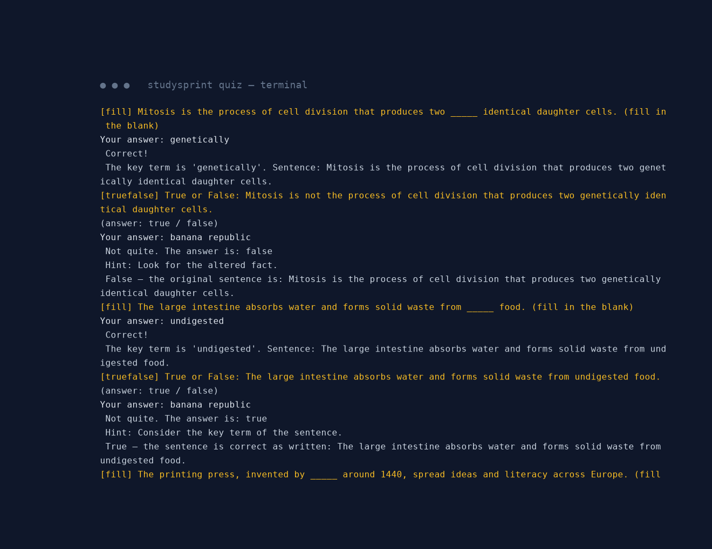
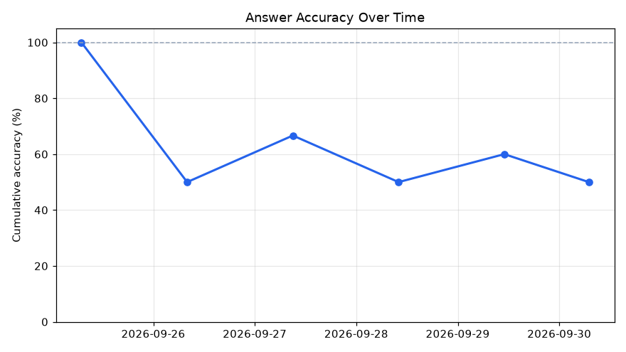
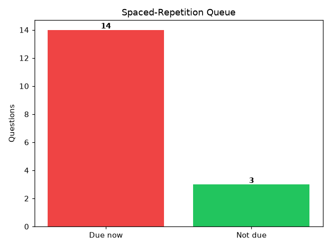
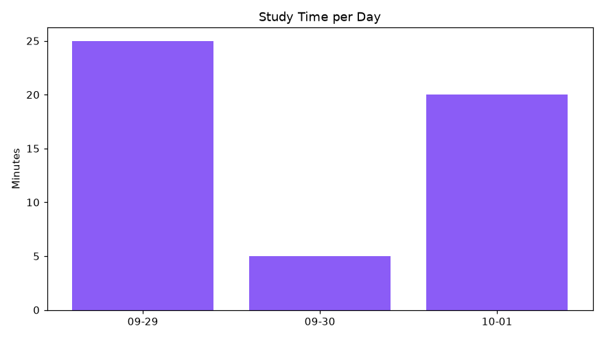

# StudySprint ⚡📝


## The Problem

Every exam season, students drown in notes and re-read them passively — the
single least effective study technique. What actually works is **active
recall**: testing yourself forces your brain to retrieve, which is what builds
long-term memory. But writing your own practice questions is tedious, so most
people never do it.

## The Solution

**StudySprint** turns your own markdown/text notes into quizzes automatically —
fully **offline**, no APIs, no accounts, no cloud. Point it at your notes, and
in seconds you get fill-in-the-blank, true/false, and WH questions with a
spaced-repetition review queue, a pomodoro focus timer, and matplotlib progress
charts. Cram smarter, not longer.

## Demo (60 seconds)

```bash
git clone <repo> && cd studysprint
pip install -r requirements.txt

# 1. Turn the bundled sample notes into a question deck
python3 -m studysprint ingest samples/ --top 8
# 📄 Loaded 26 sentences from samples/
# ⭐ Extracted 8 key sentences
# ❓ Generated 17 questions → deck now holds 17 new cards

# 2. Quiz yourself — answers are checked with paraphrase-tolerant matching
python3 -m studysprint quiz --n 5

# 3. Review what's due (spaced repetition)
python3 -m studysprint review

# 4. Focus with a pomodoro, then visualize progress
python3 -m studysprint pomodoro 25
python3 -m studysprint charts --out assets/
python3 -m studysprint stats
```

**Quiz session (real output):**



**Progress charts (real output from a scripted demo run):**





## Features

- 📥 **Notes ingestion** — reads `.md`/`.txt` files or whole directories; strips markdown (headings, lists, links, code blocks, emphasis) and splits clean sentences.
- ⭐ **Key-sentence extraction** — frequency-based scoring written from scratch: normalized TF-IDF weighting + sentence-position boost + length penalty. No NLTK, no spaCy.
- ❓ **Question generation (3 template types)**
  - *Fill-in-the-blank*: masks the most specific key term (`_____`).
  - *True/False*: true variant plus a false variant created by negating the verb (word-boundary safe) or swapping in a distractor term.
  - *WH-questions*: heuristic transforms — *What is X called?*, *When did this happen?*, *What did X cause?*, *How many…?*
- 🧠 **Paraphrase-tolerant answer checking** — normalized exact/substring match + 60% content-token overlap, so "powerhouse of the cell" and "cell's powerhouse" both count.
- 🔁 **Spaced-repetition-lite scheduler** — SM-2-style per-card easiness/intervals stored in SQLite: correct → interval grows (1d → 6d → ×easiness, capped 30d); wrong → reset to due-now with an easiness penalty. `review` serves due cards.
- 🍅 **Pomodoro timer** — `pomodoro 25` with live console countdown and session logging.
- 📊 **Progress charts** — accuracy-over-time curve, due-queue bars, study-time-per-day bars (matplotlib).
- 📦 **Bundled sample notes** — biology (cell biology) + history (revolutions), so it runs out of the box.

## Tech: the techniques under the hood

| Piece | Technique |
|---|---|
| Sentence scoring | Normalized term-frequency × IDF, position weighting, length penalty (from scratch, local stopword list) |
| Blank generation | Rarest-in-sentence content word = key term, masked via case-insensitive regex |
| False statements | Verb negation (`\bis\b` → `is not`, …) with distractor-term fallback |
| WH questions | Regex pattern transforms (definition / containment / date / causation / quantity) |
| Answer checking | Unicode normalization + stopword-filtered token overlap (≥ 0.6) |
| Scheduling | SM-2-inspired intervals (1 → 6 → ×easiness, max 30d), SQLite persistence |
| Charts | matplotlib (Agg backend, no display needed) |

Everything is local. Zero API calls, zero API keys, zero network.

## Project Structure

```
studysprint/
├── studysprint/          # the package
│   ├── __main__.py       # CLI: ingest | quiz | review | pomodoro | charts | stats
│   ├── ingest.py         # markdown/text → clean sentences
│   ├── extract.py        # frequency-based key-sentence scoring
│   ├── questions.py      # fill-blank / true-false / WH templates
│   ├── checker.py        # paraphrase-tolerant answer matching
│   ├── quiz.py           # interactive quiz runner
│   ├── scheduler.py      # spaced-repetition SQLite store + session logging
│   ├── pomodoro.py       # focus timer with console countdown
│   └── charts.py         # matplotlib progress charts
├── samples/              # bundled notes: biology.md, history.md
├── tests/                # 27 real tests (pytest)
├── assets/               # hero banner, quiz screenshot, progress charts
├── requirements.txt      # matplotlib, numpy
├── LICENSE               # MIT
└── README.md
```

## Testing

```bash
TMPDIR=~/workspace/.pytest-tmp python3 -m pytest tests/ -q
# 27 passed
```

Tests are behavioral, not stubs: extraction ranks content sentences above filler,
every generated question has a valid non-empty answer, the scheduler's due-logic
is time-travel tested (correct → 1d → 6d; wrong → due now), the checker accepts
paraphrases and rejects wrong answers, charts render valid PNGs.

## Roadmap

- [ ] Multiple-choice distractors ranked by embedding similarity
- [ ] Anki `.apkg` export
- [ ] Difficulty-aware scheduling (per-card + per-topic easiness)
- [ ] Web UI with the same offline engine
- [ ] PDF notes ingestion

## License

MIT — see [LICENSE](LICENSE).
